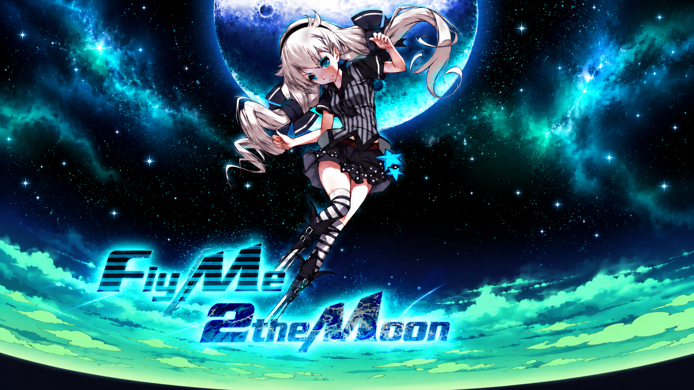

# FlyMe2TheMoon

本项目是基于自研 [ElysiaEngine](https://github.com/Akil0814/ElysiaEngine) 的 **2D 飞行闯关复刻项目**，使用 **C++23、SDL3、Box2D 与 Lua** 开发。

项目以米哈游早期作品《FlyMe2TheMoon》的关卡数据、剧情脚本和视听素材为参考，在 Android 手机上重新实现飞行控制、物理机关、收集、剧情演出与菜单系统。玩家通过向下或斜向喷射获得推力，在重力与惯性之间调整飞行路线，避开障碍、收集星星和宝石，最终抵达月亮。

本项目仅用于游戏开发学习与原作机制研究，是**非官方复刻项目**。

原本打算采用 **WDD（Wish-Driven Development，许愿驱动开发）**，试试把需求、引擎和素材交给 AI，让它自己把游戏做完。但由于过高的 Token 消耗，以及生成代码的质量和可读性问题，最终还是人工介入了。

而且即使人工介入了 Game Layer 中相当一部分代码的可读性还是很屎。（

如果你喜欢这个项目，可以去给 [miHoYo](https://www.mihoyo.com/) 氪金（



## 项目内容

- **飞行与物理**：支持触屏点按推力，包含渐进推力、转向、重力、惯性与碰撞。
- **关卡与机关**：导入 60 关地形与对象数据，实现移动平台、旋转机关、尖刺、风场、传送门、激光、发射器和炸弹等机制。
- **剧情与演出**：通过 Lua 驱动关卡事件、对白、教程和镜头移动，接入角色动作、出生与死亡、传送、终点和收集特效。
- **收集与进度**：每关三颗星，区分大小宝石；记录关卡成绩、最佳时间、死亡次数、剧情标记与本地成就，按关卡依赖解锁后续内容。
- **横屏界面**：包含主菜单、选关、成就图册、设置和制作名单，以及局内 HUD、暂停、结算与新纪录提示。
- **设置与音频**：支持帧率、垂直同步、音量与语言设置，接入背景音乐、语音和音效。
- **开发工具**：F2 面板提供调试绘制、帧率统计、时间倍率和关卡相机控制；提供自动化测试、输入回放及资源检查工具。

## Android 构建与操作

当前分支面向 **Android 8.0 及以上的 ARM64 手机**，生成可离线运行的 Debug APK 与正式签名 Release APK，不维护桌面构建。

使用 PowerShell 7 和 JDK 21，在项目根目录执行：

```powershell
./android/tools/setup-android.ps1 -AcceptLicenses
./android/tools/new-release-key.ps1
./android/tools/test-host.ps1
./android/tools/build-android.ps1 -Variant All
```

发布密钥只生成一次，保存在 Git 外，须安全备份；后续更新复用同一密钥。APK、签名信息与校验和位于 `out/android/dist/`。

按住屏幕位置产生飞行推力，松手停止；菜单与设置直接触摸。系统返回在关卡中打开/关闭暂停，在子菜单返回上级，在主菜单弹出退出确认。切后台后关卡保持暂停，需要手动继续。

完整资源随 APK 分发，首次启动会在应用内部准备约 145 MiB 的资源。资源与存档独立存放，资源更新保留进度；卸载或清除应用数据会删除存档。Android 版关闭 F2 面板和桌面窗口设置。

完整说明见 [Android 构建、签名与验证](docs/development/android.md)。

## 引擎相关

本项目基于 **ElysiaEngine** 开发。ElysiaEngine 负责底层运行时与通用引擎能力，FlyMe2TheMoon 的游戏逻辑及 Lua 相关实现位于 Game Layer。

更多技术文档及引擎源码请参考：[ElysiaEngine](https://github.com/Akil0814/ElysiaEngine)。

## 许可与素材来源

本项目自行编写并有权授权的代码采用 [MIT License](LICENSE)。第三方库遵循各自的许可证，具体来源见[第三方依赖说明](thirdparty/SDL3-DEPENDENCIES.md)及相关组件附带的许可文件。

《FlyMe2TheMoon》原作的名称、角色、美术、音频、剧情及其他受保护内容归各自权利人所有，**不属于本项目 MIT 许可证的授权范围**。本项目是非官方学习与研究性质的复刻，与 miHoYo 无官方关联。

本项目对原作资料的使用旨在学习、研究与本地验证。版权声明不代表取得原作内容的复制、改编或再分发授权。


### AI 辅助素材处理声明

本项目的部分美术素材使用了 AI 工具进行辅助调整，包括但不限于画面扩展、背景补全、尺寸适配及局部视觉修改。

相关处理主要用于适配 ElysiaEngine 的渲染方式、屏幕比例与游戏界面需求，并非意图替代原作的美术设计。

原始素材及其相关知识产权仍归原权利人所有。AI 辅助修改不代表本项目取得了原始素材的所有权或再分发授权，相关素材亦不属于本项目 MIT License 的授权范围。
