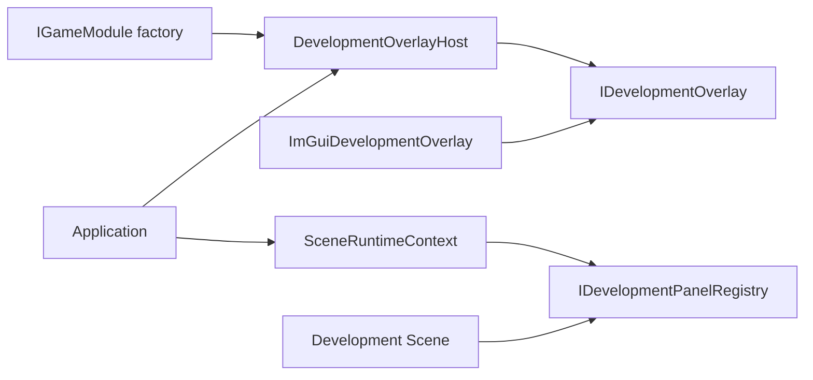

# 开发覆盖层与 Dear ImGui

本文解释开发覆盖层与正式 UI、输入和应用生命周期的边界。开发面板在场景退出前解除注册，覆盖层则在渲染器关闭前释放后端资源。

`DevelopmentOverlay` 是引擎提供给开发工具的可选覆盖层插槽。正式 UI、场景、物理和游戏玩法 只依赖通用面板注册接口；`Application` 只编排通用生命周期，不包含 `imgui.h`，也不直接调用任何 Dear ImGui API。

构建开关、工厂接入和面板注册示例见[开发面板指南](../../user-guide/tools/development-panels.md)。

## 分层与所有权

- `IGameModule::create_development_overlay()` 默认返回空；项目只有在启用构建中才创建具体适配器。
- `DevelopmentOverlayHost` 独占适配器，保留 F2，通过 `set_panels_visible()` 通知面板可见性。隐藏时仅在适配器的 `has_background_content()` 返回 true 时继续逐帧调用，用于独立 FPS 浮层；默认实现返回 false。
- `SceneRuntimeContext` 只暴露可空 `IDevelopmentPanelRegistry`，场景不知道 Host 或适配器的具体类型。
- `ImGuiDevelopmentOverlay` 独占 ImGui 上下文、默认字体图集 和两个官方后端。
- 关闭流程顺序为 `SceneManager`、覆盖层、资源、渲染器、窗口、SDL，保证场景能先注销捕获自身的回调。

## 帧与输入语义

1. 每个 SDL 事件先交给覆盖层宿主；F2 的按下和释放由覆盖层宿主消费，不进入游戏 RawInput。
2. 覆盖层可见时，普通事件交给 ImGui 后端，同时继续走 `InputSystem` 的窗口和设备生命周期处理。
3. `InputSystem` 使用上一完整 ImGui 帧 的 `WantCaptureKeyboard`、`WantTextInput` 和 `WantCaptureMouse` 抑制键盘、文字或指针 RawInput。
4. 开始捕获时清理对应按住状态和鼠标增量，避免场景收到卡住的按键；结束指针捕获时刷新逻辑鼠标位置。
5. 覆盖层不请求 手柄捕获，也不启用 ImGui 手柄导航；手柄事件始终继续交给游戏。
6. 更新前以 `Time::raw_delta()` 调用 `begin_frame()`，使模拟暂停或慢放不影响工具交互与 FPS；场景、`DebugDraw` 和正式 UI 绘制后调用覆盖层 `render()`；最后才 `SDL_RenderPresent()`。
7. 隐藏面板时清理 ImGui 的输入队列及按住状态；后台 FPS 浮层使用 `NoInputs`，不执行注册面板回调，不请求输入捕获。

适配器绘制前保存 SDL Renderer 的渲染目标、逻辑呈现尺寸与模式（logical presentation）、缩放、视口、裁剪、绘制颜色和混合模式，绘制后按正确依赖顺序恢复，避免污染正式渲染。

## 注册表执行边界

面板绘制使用批次快照；绘制期间的增删排队，下一批次生效。注册表不拥有回调捕获的业务对象，场景退出时必须先解除注册。

回调异常交给应用 render boundary，记录 `UnhandledException` 并进入 FaultExit，不尝试回滚任意 ImGui 状态。完整调用与生命周期条件见[面板指南](../../user-guide/tools/development-panels.md#注册与注销)。
