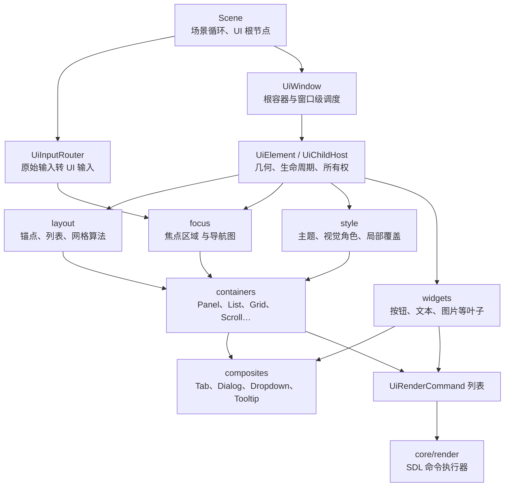
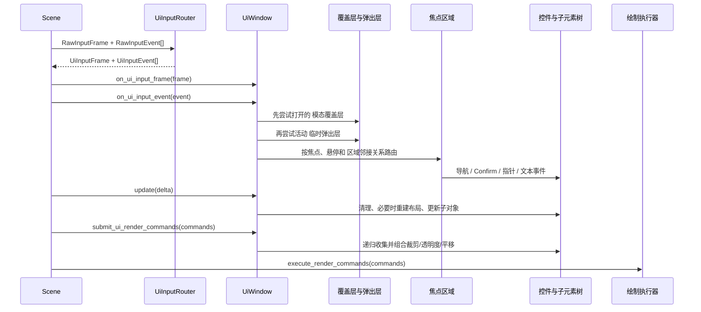
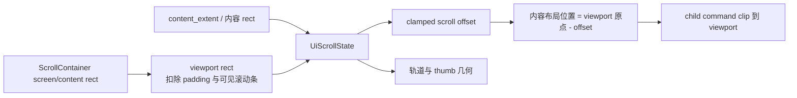
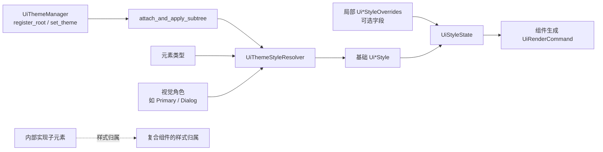

# UI 架构与运行流程

本文面向维护 UI 实现的开发者，沿元素树、一帧执行、布局呈现、焦点表面和主题传播解释模块协作。游戏接入见[UI 使用指南](../../../user-guide/ui/README.md#create-window)，接口查询见[UI 参考](../../../reference/ui/README.md)。

<a id="element-tree"></a>
## 元素树与所有权

Elysia Engine 的 UI 属于 **保留模式（retained-mode）UI**：代码创建 `UiElement` 对象并长期保留为一棵树；每帧更新树的状态，布局在需要时重建，最后由树收集渲染命令。控件本身不直接调用 SDL 绘制 API。



这张图里最重要的边界有三个：

1. `engine/ui` 负责 **状态、布局、输入和命令生成**；它不负责真正画到 SDL 渲染器。
2. `UiChildHost` 是容器能力的共同地基，具体容器主要是在它的基础上替换“如何布局”和“如何形成焦点图”。
3. `UiWindow` 不是 OS 窗口包装器，而是一个 UI 根容器：它承担跨焦点区域焦点、覆盖层、弹出层、提示和滚动路由等窗口级语义。

`Scene` 是 UI 与游戏循环的接缝。它保存 UI 根节点，按 UI `order` 处理根节点，并在 [scene.cpp](../../../../../engine/scene/scene.cpp) 中把 `UiRenderCommand` 批量交给渲染基础设施执行。

[`UiChildHost`](../../../../../engine/ui/core/ui_child_host.h) 同时继承 `UiElement`、`Updatable`、`UiInputFrameReceiver` 和 `UiInputEventReceiver`。这使一个容器既是树节点，也是子树的更新、输入和渲染调度者。

接管子对象时，容器会建立 `layout_parent` 反向链接、使布局失效，并在已有主题管理器时附着/应用主题子树。移除和 reset 时会反向解除这些关系。因而“容器负责拥有树，窗口/主题/布局只保存借用注册关系”是阅读代码时必须保持的心智模型。

构造、提取和释放的公开所有权契约见[元素与布局](../../../reference/ui/elements-and-layout.md#ownership)。内部子项还保存生命周期记录；遍历使用可验证的句柄，以便在回调修改树后识别已经移除或销毁的对象。

<a id="frame-flow"></a>
## 一帧如何执行

场景的内部生命周期输入入口委托 `SceneInputRouter`，先将 `RawInputFrame` 交给 `UiInputRouter::route_frame`，再将离散的原始事件转换为 `UiInputEvent`；必要时还会合成连续动作事件。随后场景按 UI 输入顺序分发 frame 和 event。`UiInputFrame` 适合查询“当前是否按住”，`UiInputEvent` 适合处理一次按下、滚轮、指针移动和文本输入等离散行为。下图概括主要协作路径，省略无输入、暂停和已消费事件等分支。



严格说，布局并不只发生在 `update`：`UiChildHost` 在输入和提交渲染命令之前也会调用 `update_layout_if_dirty()`。这样可以避免“刚改完内容就点击/渲染，但还没有等到下一次更新”的陈旧几何问题。它是一种按需、延迟的布局策略。

场景的内部生命周期更新入口在普通更新后单独递归调用 `update_presentation_animations(delta)`，这一遍历期间不能增删场景对象。游戏在 `on_before_update` / `on_after_update` 扩展，无需调用基类调度。这解释了为什么平移动画不应改布局 rect：动画保持布局几何不变，指针命中通过呈现到布局的转换跟随画面。

`SceneInputRouter`（`engine/scene/input/`）先协调 UI 消费与设备捕获，再把允许的输入交给快捷操作和本地控制器。键盘捕获覆盖键盘分区，鼠标捕获关联鼠标所属玩家，手柄捕获只针对指定 UI 手柄；公开交互条件见[输入参考](../../../reference/ui/input-and-focus.md#capture-and-cancel)。

交互取消可能调用业务回调。`UiChildHost` 和场景输入路由用稳定生命周期快照处理整批对象：回调移除的对象不再访问，新加对象不加入当前批次；捕获首个异常后继续取消其他仍存活的对象，最后再传播异常。

<a id="layout-presentation"></a>
## 布局失效与呈现合成

**布局失效链**：子元素尺寸或内在内容改变时，`UiElement::notify_layout_parent_of_intrinsic_layout_invalidation()` 通知父容器；父容器标记待重建，并继续向自己的父级冒泡。`UiChildHost` 用 `_is_rebuilding_layout` 和 `_layout_dirty_after_rebuild` 避免重建过程中再次失效导致递归混乱。父容器应通过内边距、子元素选项或容器 API 调整布局，不应靠手工改子元素 rect 与父布局“对抗”。

**渲染合成**：容器过滤 destroyed/invisible 子项，按 `order` 做稳定排序，让每个子项追加命令。对子项新增的那一段命令，容器再依次应用子项呈现位移、父级透明度和可选的 `content_rect()` 裁剪。这样一个父容器可以统一实现裁剪与透明度，不要求每个叶子控件重复处理。

`screen_rect` 是已分配的布局矩形，`content_extent()` 向父级报告测量尺寸。呈现位移通过 `presentation_screen_rect()` 与 `presentation_to_layout_point()` 连接渲染和输入。透明度、裁剪和位移只应用到对应子项追加的命令范围；绘制最终由 UI 模块之外的渲染基础设施执行。

容器的锚点、内边距、尺寸覆盖与交叉轴字段见[布局参考](../../../reference/ui/elements-and-layout.md#fixed-layout)。下面保留不同容器的实现差异。

文本组件将测量结果交给父布局，再提交文字命令。`UiNumber` 按字符复用本地化纹理缓存，并使用公共字形序列排版算法生成命令；目标高度与缩放不会创建不同尺寸的字体纹理，`--` 的两个字符也共享同一张减号纹理。格式化与排版仍在每次提交命令时执行。

### UiPanel：锚点布局与方向邻接

`UiPanel` 适合“不是纯列表或纯网格”的局部布局。直接以 `UiLayoutChildOptions` 添加时，它调用锚点布局；调用 `add_child(child, UiPanelInsertDirection)` 时，会相对最近的可聚焦插入点向 Up/Down/Left/Right 推进，并记录 `FocusLink`。后续 `rebuild_focus_registry()` 将这些方向关系转成控制项的邻接图。

所以面板的插入方向不只是视觉位置提示，也会影响焦点导航。嵌套的子元素焦点区域则通过委托保留自身导航图。面板还持有 `UiPanelStyle` 与 `UiPanelVisualRole`，适用于需要背景、边框或对话框等语义视觉角色的表面。

**避免的用法**：把面板当可无限扩展的纵向列表，或在添加后手动不断修改子元素矩形。前者应选择列表；后者会让下一次待重建布局覆盖手工位置。

### UiListContainer：一维流式布局

列表将 `UiListDirection::Vertical` / `Horizontal` 转换为布局层的主轴。`rebuild_layout()` 读取每个子元素的尺寸覆盖或 `content_extent()`，按子元素顺序加上 `item_spacing` 依次排放，再按 `cross_align` 处理交叉轴的 Start/Center/End；必要时可以填满交叉轴。`content_extent()` 因而会把所有项目尺寸、间距和内边距汇总，供外层列表或滚动容器测量。

焦点同样遵守一维语义：主轴方向的导航优先在相邻项目/委托焦点区域之间流动；不是主轴的方向可以留给上层焦点区域。`add_front` 和 `add_back` 分别改变列表顺序，因此也会影响布局、绘制和焦点邻接。

### UiGridContainer：二维单元与二维导航

网格用 `column_count`、`cell_spacing` 和 `fill_by_row` 配置规则。布局层基于当前子元素数推导行/列位置，并为每个子元素分配 cell；`fill_by_row=true` 是通常的从左到右再换行，设为 false 则按列填充。`content_extent()` 与 cell 尺寸、行列数、间距和内边距对应。

与列表的顺序邻居不同，网格的焦点登记表使用行/列坐标构建上、下、左、右邻居。因此它适合真正二维的选择界面；若只是两列设置表单但希望页签顺序式导航，列表 + 面板往往更直观。

### UiScrollContainer：内容、视口与输入路由

ScrollContainer 是最值得细读的容器。它继承 `UiChildHost`，同时实现 `UiFocusScope`，但其公共语义是 **只管理一个内容**：`set_content`、`content`、`clear_content`。内部维护 `UiScrollState`，该状态由视口 size、内容 size、偏移、模拟步和 axis 决定。



- `UiScrollAxis::Auto` 根据内容是否在 x/y 超出视口解析为 Horizontal、Vertical 或 Both；`max_scroll_offset` 是内容大小减视口大小后再限制到非负值。
- `rebuild_layout()` 测量内容、同步状态、计算是否出现滚动条、重新计算实际视口，并将内容放到 `viewport.position - scroll_offset`。它强制 `clip_children=true`，防止溢出内容画到视口外。
- 滚动条可 Hidden、Visible 或 Auto。它由内部 `UiDragHandle` 作为滚动柄，但滚动条语义仍由 ScrollContainer 控制：滚动柄的位置映射到 `UiScrollState` 的比例，再换算为偏移。
- 事件路径按优先级处理：正在拖拽的滚动条先处理；指针滚轮可先交给命中的内容；未消费时容器尝试应用滚轮；普通指针/动作事件按命中区域委托给内容。`PageUp`、`PageDown`、`Home`、`End` 等被动滚动输入由窗口协同派发。
- 容器把内容焦点区域作为自己的焦点目标。手柄滚动实际移动时可临时清掉内容焦点、在合适时恢复，避免焦点提示与正在滚动的视觉行为冲突；有焦点的子控件在相应输入后会通过 `ensure_visible` 自动滚入视口。

嵌套 ScrollContainer 的关键不是“所有父层一起滚”，而是窗口从逻辑焦点路径向内优先派发，深层可滚动容器优先消费。为此不要绕开 `UiWindow` 手工给每层发送页面滚动事件。

### UiChromeContainer：标题栏与主体的内部组合

ChromeContainer 展示了本项目偏好的复合方式：它在 `reset()` 中创建四个内部容器——左操作列表、标题槽位、右操作列表、主体槽位。外部 API 不暴露这些内部实现，而是提供 `add_left_action`、`add_title_child`、`add_right_action`、`set_body` 等意图明确的方法。

`rebuild_layout()` 根据标题栏是否可见、标题栏高度、标题栏与主体内边距，先分出标题栏与主体 rect，再布置四个槽位。标题栏的 action 列表使用一个特殊内部 list：它保留列表布局能力，但不会把自身作为独立焦点区域，避免内部结构泄漏进对外导航。

焦点上，标题栏的直接控件由标题栏容器管理；主体如果本身是 `UiFocusScope`，则进入 delegated 主体焦点区域。指针命中标题栏与主体会决定当前事件路由区域；键盘/手柄则可以在标题栏与主体之间进入/离开。样式上，内部子元素标记为复合组件内部实现，主题刷新会归属到标题栏容器的语义样式而不是把它们误当独立组件根。

### 页签和选择组：状态同步型容器

`UiTabView` 只显示 `_selected_index` 对应的页面：其他页面同时 `visible=false`、`active=false`，因此不会绘制、更新或接收输入。选择变化会重建布局与焦点注册表；焦点会委托给选中页面的焦点区域。`UiTabContainer` 则在上层组合 `UiTabBar` 与 `UiTabView`，负责 tab 标签、当前焦点 tab 与选中 page 的联动。

`UiButtonGroup` 建立在 `UiListContainer` 上，只接收 `UiButton`。它在按钮 click 回调前插入组内选择逻辑，维护一个选中按钮，并用 `Primary` / `Default` 视觉角色刷新样式；若开启 `auto_select_first`，失去当前选择时会补选第一个有效按钮。

`UiRadioGroup` 同样是列表，但面向实现 `UiRadioItem` 的成员。同步时它优先保留当前聚焦且已选中的项，否则保留第一个已选项，若都没有则选择第一个单选按钮，并清除其余项。选择变化可由 `set_on_selection_changed` 得到一次回调；渲染路径中的延迟同步会用 pending 标志避免无意丢失通知。

<a id="focus-surfaces"></a>
## 焦点树与窗口表面仲裁

`UiControl` 添加了 enabled/focused 等交互语义；`UiFocusScope` 定义一个可独立接管导航边界的协议；`UiControlFocusScopeHost` 则把它们结合起来。它维护 `FocusEntry { control, neighbors }`，并在显式生命周期边界同步：清理失效子元素、更新布局、重建焦点登记表、修复失效焦点、将焦点视觉状态推给控件。

方向键或手柄导航的基本规则是：先让当前控件处理事件；若未消费，则在当前焦点区域的 `UiFocusNeighbors` 中找邻居；到边界时 `UiWindow` 才根据 `UiFocusScopeNeighbors` 尝试切到另一个焦点区域。指针设备还可使用悬停焦点策略，窗口会记录最近驱动焦点决策的输入设备，以区分鼠标与键盘/手柄体验。

嵌套容器不能简单把所有后代控制项压成一个列表。`UiDelegatedFocusMixin` 让面板、列表、标题栏容器、页签等组合容器把焦点交给内部的子焦点区域；父容器保留“进入/退出哪个区域”的职责。这正是嵌套滚动页、页签页面和标题栏容器主体可以各自导航而不会丢失层级的原因。

窗口保存区域、覆盖层、临时弹出层和提示的借用登记。焦点清理区分“暂不可用”和“已脱离所有权树”：隐藏或停用只抑制选择与导航，保留登记顺序、邻接关系和仍有效的历史焦点；已销毁或离开子树的区域才被移除。

打开模态层前记录可恢复的区域，关闭时恢复仍可用的历史区域，否则重新选择。窗口先协调模态覆盖层、活动弹出层，再将输入交给普通区域；提示保持被动并最后绘制。放置、过渡与关闭选项属于窗口登记状态，不等于元素本身的对象寿命。完整条件见[窗口表面参考](../../../reference/ui/windows-and-popups.md)。

<a id="theme-flow"></a>
## 主题如何传播到子树

主题不是每个控件各自读取全局颜色。`UiThemeManager` 注册根节点后，会附着并应用整棵子树；`UiThemeStyleResolver` 根据元素类型和视觉角色取基础样式；`UiStyleState` 再把仅设置了字段的覆盖配置叠到基础样式上。



`UiChildHost` 对新接管的子元素自动附着已存在的主题管理器；`on_child_base_style_invalidated` 则识别复合组件内部实现子元素，转而刷新其语义所有者。这样标题栏容器、对话框、页签等组合组件的内部节点能够跟随整体语义主题，而不会被错误地当成用户放置的独立主题根。

局部覆盖配置用于“同一主题下刻意只改某些字段”；直接把完整基础样式复制到业务层会削弱换主题的能力。视觉角色用于“它在设计上是什么”（例如 `Primary`、`Danger`、`Dialog`），两者不要混用。

`UiThemeStyleResolver` 决定类型适配及后续遍历策略；整棵树的遍历由 `UiThemeManager` 完成。`UiStyleState` 合成基础样式与稀疏字段覆盖，不负责树的生命周期。默认主题、注册对象及颜色角色契约见[样式参考](../../../reference/ui/style-and-theme.md)。

<a id="extension-checks"></a>
## 自定义控件与排错

新增容器前，先决定它是简单 `UiChildHost`，还是还需要成为 `UiFocusScope` / `UiControlFocusScopeHost`。然后逐项检查：

1. **所有权**：是否只通过 `unique_ptr` 接管子元素；移除/reset 时是否清理所有借用注册和缓存裸指针？
2. **布局**：哪些设置会 `mark_layout_dirty()`；`content_extent()` 是否反映子内容；重建时是否只写子元素的已分配 rect？
3. **输入**：frame 广播与离散 event 的顺序是否一致；命中、拖拽和已消费事件是否会错误地继续向下传？
4. **焦点**：是否重建注册表；子元素被禁用、隐藏、销毁时能否修复焦点；嵌套焦点区域是合并还是委托？
5. **渲染**：是否尊重 visible/order；父级透明度、呈现位移与裁剪是否只应用一次且范围正确？
6. **主题**：是否拥有明确视觉角色与样式状态；内部实现子元素是否应标记为复合组件内部实现？
7. **测试**：至少覆盖子元素移除、尺寸改变后的重布局、键盘/手柄导航、指针命中、嵌套容器，以及主题或表面注册的生命周期。

高频故障通常来自四类误解：保存了已被容器销毁的借用指针；直接改子元素矩形却忘记父布局会重建；注册 overlay/popup/tooltip 后没有处理生命周期；把嵌套焦点区域当成普通子元素而跳过委托。遇到问题时，先检查这些边界，再检查具体控件逻辑，效率通常更高。

<a id="source-reading"></a>
### 从示例与测试阅读实现

[`ui_component_gallery_scene.cpp`](../../../../../game/showcase/ui/ui_component_gallery_scene.cpp) 是阅读组合结构的综合入口。它建立如下真实结构：

```text
UiWindow
├── 状态 UiLabel
├── UiTabContainer
│   ├── UiTabBar（内部）
│   └── UiTabView（内部）
│       └── 每个页面： UiScrollContainer
│           └── UiListContainer
│               └── UiChromeContainer
│                   ├── 标题栏操作与标题（内部槽位）
│                   └── 主体： UiListContainer / UiPanel / 各种控件
├── 覆盖层 UiPanel / UiDialog / UiConfirmationDialog
└── UiTooltip
```

建议先从场景的界面重建入口了解页签和公共窗口，再阅读同目录中的 `ui_gallery_pages.h` 与 `ui_component_gallery_content.cpp`，观察滚动容器包住列表、标题栏与主体组合，以及容器、弹出层和主题页面的配置。这里所有 `get()` 保存的指针都是在 `std::move` 转交所有权前取得的借用指针，生命周期受最终容器控制。

测试与实现互相印证：

- [`ui_callback_safety_tests.cpp`](../../../../../tests/ui/ui_callback_safety_tests.cpp)、[`ui_style_tests.cpp`](../../../../../tests/ui/ui_style_tests.cpp)、[`ui_popup_lifecycle_tests.cpp`](../../../../../tests/ui/ui_popup_lifecycle_tests.cpp) 与 [`ui_presentation_tests.cpp`](../../../../../tests/ui/ui_presentation_tests.cpp)：所有权、移除、主题附着、overlay/tooltip 生命周期与渲染范围。
- [`ui_focus_tree_tests.cpp`](../../../../../tests/ui/ui_focus_tree_tests.cpp)：列表、网格、面板、滚动容器、标题栏容器的嵌套焦点行为。
- [`ui_focus_routing_tests.cpp`](../../../../../tests/ui/ui_focus_routing_tests.cpp)：窗口级焦点区域路由、嵌套滚动与指针/手柄策略。
